# German Pop Culture Dataset
[](https://github.com/kleinnconrad/dataset.popculture.germany/actions/workflows/ci.yml)

A dataset of the state of German pop culture, week by week: what people listen to, watch, read, play and search for, which artists, shows, films, festivals and products the media push, which ways of living they recommend, and which opinions pop culture voices on politics (e.g. the Bundeswehr), religion, family, marriage, children and alternative lifestyles. A pipeline in GitHub Actions runs twice a week (Tuesdays and Fridays) for at most 30 minutes. It stores volatile sources as they change (music, podcast, app, book and audiobook charts, trending searches, the most viewed Wikipedia articles), keeps a stable backbone of daily Wikipedia views of 215 registered artists, shows, festivals, brands, institutions and concepts since 2015, and collects the pop culture news of German outlets and the press releases of industry associations, labelled with Google Gemini (`gemini-2.5-flash`). Everything is stored as partitioned JSON files in this repository and can be correlated with the other datasets of this series.

## Table of Contents
- [Variable Overview](#variable-overview)
- [Dataset Overview](#dataset-overview)
- [Datasets](#datasets)
  - [Volatile Sources: Chart Snapshots](#volatile-sources-chart-snapshots)
  - [Stable Backbone: Wikipedia Views](#stable-backbone-wikipedia-views)
  - [News Items, Press Releases and Annotations](#news-items-press-releases-and-annotations)
- [What the Variables Measure](#what-the-variables-measure)
- [Weekly Indicators](#weekly-indicators)
- [Correlation with Other Datasets](#correlation-with-other-datasets)
- [Data Model](#data-model)
- [Example Records](#example-records)
- [Sources and Fetch Rules](#sources-and-fetch-rules)
- [Pipeline](#pipeline)
- [Data Files](#data-files)
- [Workflows](#workflows)
- [Configuration](#configuration)
- [Running Locally](#running-locally)
- [Continuous Integration](#continuous-integration)
- [Setup](#setup)
- [Sources and Attribution](#sources-and-attribution)

## Variable Overview

The table lists the variables that carry content and the dataset (table) that stores them. Every chart is stored as a list of entries in `chart_snapshots`, one record per new state of the list; the example names the first entry of a list observed on 2026-10-28 (2026-10-26 for the daily lists). All charts are listed in [config/charts.toml](config/charts.toml) and in `chart_catalog`. Not listed are the fields that every record has, the chart catalog and the entity registry, ids that link the datasets, URLs, coverage dates and the bookkeeping of revisions and annotations; all fields are in the [Data Model](#data-model). The examples of `text_annotations` show the format of the labels.

| Variable | Table | Description | Example |
|---|---|---|---|
| Chart `apple.music_top_songs` | `chart_snapshots` | The 100 most played songs on Apple Music in Germany | 1. `Housewife – Tate McRae` |
| Chart `apple.music_top_albums` | `chart_snapshots` | The 100 most played albums on Apple Music in Germany | 1. `The Life of a Showgirl: The Encore – Taylor Swift` |
| Chart `apple.podcasts_top_shows` | `chart_snapshots` | The 100 top podcasts on Apple Podcasts in Germany | 1. `RONZHEIMER. – Paul Ronzheimer` |
| Chart `apple.podcasts_top_episodes` | `chart_snapshots` | The 100 trending podcast episodes on Apple Podcasts in Germany | 1. `Israel: Ein Land, zwei Wirklichkeiten / Handel: Merz für Freihandel mit Asien` |
| Chart `apple.apps_top_free` | `chart_snapshots` | The 100 top free iPhone apps in the German App Store | 1. `AOK Ident` |
| Chart `apple.apps_top_paid` | `chart_snapshots` | The 100 top paid iPhone apps in the German App Store | 1. `Blitzer.de PRO` |
| Chart `apple.books_top_paid` | `chart_snapshots` | The 100 top paid e-books on Apple Books in Germany | 1. `A Court of Splintered Harmony – Sarah J. Maas` |
| Chart `apple.books_top_free` | `chart_snapshots` | The 100 top free e-books on Apple Books in Germany | 1. `Ausgerechnet Sylt – Thomas Herzberg` |
| Chart `apple.audiobooks_top` | `chart_snapshots` | The 100 top audiobooks on Apple Books in Germany | 1. `Der erste Fall für Detective Cross – Tim Sullivan` |
| Chart `google_trends.trending_searches_de` | `chart_snapshots` | Search terms trending on Google in Germany, with approximate searches and the first news article | 1. `elterngeld` (500+ searches) |
| Chart `wikimedia.top_articles_dewiki` | `chart_snapshots` | The 100 most viewed articles of the German Wikipedia per day, without main pages and pages that are not articles | 1. `Ballon d’Or` (64,869 views) |
| Chart `wikimedia.top_articles_germany` | `chart_snapshots` | The 100 most viewed Wikipedia articles from Germany per day, all language editions | 1. `Walter Koenig` (de.wikipedia, 54,900 views) |
| `chart_date` | `chart_snapshots` | Day the list refers to | `2026-10-28` |
| `entries` | `chart_snapshots` | Positions of the list with title, creator, genres, release date and metric | `[{"rank": 1, "title": "Housewife", "creator": "Tate McRae", ...}]` |
| `name` | `entities` | Name of a registered artist, show, festival, brand, institution or concept | `Helene Fischer` |
| `entity_type` | `entities` | Type of the entity | `person` |
| `domain` | `entities` | Field of pop culture or society the entity belongs to | `Music` |
| `daily_views` | `wikipedia_pageviews` | Views by people per day of the German Wikipedia article of an entity | `{"2026-10-24": 5914, "2026-10-25": 1914}` |
| `outlet_id` | `news_items` | Outlet that published the article | `promiflash` |
| `outlet_type` | `news_items` | Type of the outlet | `celebrity_magazine` |
| `outlet_focus` | `news_items` | Field of a specialist outlet | `Celebrities and royals` |
| `audience` | `news_items` | Main audience of the outlet | `general` |
| `title` | `news_items` | Title of the article | `Er prägte die Horrorbranche: Regisseur Peter Medak ist tot` |
| `published_at` | `news_items` | Publication time (UTC) | `2026-10-28T13:18:00Z` |
| `section` | `news_items` | Section of the outlet | `internationale-stars` |
| `feed_categories` | `news_items` | Categories of the item in the feed | `["Stars", "Internationale Stars"]` |
| `keywords` | `news_items` | Keywords of the article page or news sitemap | `["Netflix", "Serien"]` |
| `jsonld_type` | `news_items` | schema.org type of the page, e.g. news, review or opinion | `NewsArticle` |
| `is_agency_copy` | `news_items` | Credited to a news agency | `false` |
| `author_count` | `news_items` | Number of named authors (names are not stored) | `1` |
| `word_count` | `news_items` | Word count of the article | `612` |
| `is_paywalled` | `news_items` | Not accessible for free | `false` |
| `has_video` | `news_items` | Page embeds a video | `true` |
| `press_source_id` | `press_releases` | Association, broadcaster or company that issued the release | `game_verband` |
| `actor_type` | `press_releases` | Type of the issuer | `industry_association` |
| `title` | `press_releases` | Title of the release | `Auf Torjagd mit den game Sales Awards im September` |
| `published_at` | `press_releases` | Publication time (UTC) | `2026-10-14T08:15:57Z` |
| `is_pop_culture` | `text_annotations` | Item is about popular or everyday culture | `true` |
| `domain` | `text_annotations` | Main field: music, film, TV and streaming, celebrities, influencers, games, fashion, food, fitness, relationships, family, religion, politics and society and others | `TV and streaming` |
| `domains_secondary` | `text_annotations` | Up to two further fields | `["Celebrities and royals"]` |
| `issue_detail` | `text_annotations` | Specific subject in a few words | `Staffelfinale` |
| `article_type` | `text_annotations` | Form: news, review, opinion, interview, ranking, guide, shopping recommendation, gossip and others | `Shopping recommendation` |
| `works` | `text_annotations` | Songs, albums, films, series, shows, games, books and podcasts with kind, role and tone | `[{"title": "Babylon Berlin", "kind": "TV series", "role": "Recommended", "tone": "Positive"}]` |
| `people` | `text_annotations` | Public figures and groups with a German Wikipedia article, by Wikidata id, with role and tone | `[{"wikidata_qid": "Q236549", "wikipedia_title": "Helene Fischer", "role": "Subject", "tone": "Positive"}]` |
| `unresolved_person_count` | `text_annotations` | Named persons without a German Wikipedia article (names are not stored) | `1` |
| `products` | `text_annotations` | Brands, products and services with category and role (recommended, advertised, reviewed, criticized) | `[{"name": "Stanley Cup", "category": "Home and furniture", "role": "Recommended"}]` |
| `platforms` | `text_annotations` | Streaming, social media, music, gaming, shopping and dating platforms | `["Netflix", "TikTok"]` |
| `purchase_recommendation` | `text_annotations` | Recommends buying, booking or subscribing | `true` |
| `sponsored` | `text_annotations` | Marked as advertisement, sponsored or with affiliate links | `false` |
| `lifestyle_advice` | `text_annotations` | Topics of advice on a way of living | `["Fitness and exercise", "Sleep"]` |
| `family_forms` | `text_annotations` | Forms of family and relationship depicted, with the tone of their presentation | `{"Patchwork family": "Positive"}` |
| `stances` | `text_annotations` | Opinions on 62 fixed targets (Bundeswehr, conscription, churches, Islam, marriage, children, childfree living, polyamory, veganism, AI and others), with stance and holder | `[{"target": "Bundeswehr and military", "stance": "Unfavorable", "holder": "Celebrity or influencer"}]` |
| `promoted_values` | `text_annotations` | Values presented as desirable (Schwartz) | `["Hedonism", "Self-direction"]` |
| `generations` | `text_annotations` | Generations addressed or discussed | `["Generation Z"]` |
| `content_origin_countries` | `text_annotations` | Countries of origin of the works and people (ISO 3166-1 alpha-2) | `["US", "DE"]` |
| `overall_tone` | `text_annotations` | Overall tone of the item | `Positive` |
| `reports_controversy` | `text_annotations` | Reports a scandal, shitstorm, boycott or public dispute | `false` |
| `upcoming_events` | `text_annotations` | Future releases, premieres, concerts, festivals, award shows and sales with type and date | `[{"event_type": "Concert or tour", "date": "2027-03-14"}]` |
| `communication_type` | `text_annotations` | Purpose of a press release; `Not applicable` for news | `Market figures or study` |

## Dataset Overview
<!-- DATASET_OVERVIEW_START -->
**Last updated:** 2026-10-30 07:07 UTC

| Dataset | Records | Items | Files | Observed | Content |
|---|---|---|---|---|---|
| `chart_snapshots` | 1,177 | 750 | 2 | 2026-10-28 to 2026-10-30 | A chart or ranking as published at one observation; stored again only when the source changes it. |
| `chart_catalog` | 12 | 12 | 1 | 2026-10-28 to 2026-10-28 | An entry of the chart configuration, recorded when it appears or changes. |
| `entities` | 215 | 215 | 1 | 2026-10-28 to 2026-10-28 | An entry of the entity registry, recorded when it appears or changes. |
| `wikipedia_pageviews` | 215 | 215 | 1 | 2026-10-28 to 2026-10-28 | Daily views of the German Wikipedia article of a registered entity. |
| `news_items` | 1,212 | 1,212 | 1 | 2026-10-30 to 2026-10-30 | Metadata of one news article. The text is not stored. |
| `press_releases` | 0 | 0 | 0 | none | Metadata of one press release. The text is not stored. |
| `text_annotations` | 350 | 350 | 1 | 2026-10-30 to 2026-10-30 | Gemini labels of one news article or press release. |

**Runs**

- **Latest run:** 2026-10-30 06:59 UTC (normal)
  - `chart_catalog`: ok
  - `charts`: ok (chart_snapshots 15)
  - `entities`: ok
  - `feeds`: ok (news_items 1,212, text_annotations 350)
  - `wikipedia_pageviews`: not_due

**Charts**

- **Active charts:** 12; with stored lists: 12

| Chart | Lists | Latest list | First entries |
|---|---|---|---|
| Apple Music: most played songs, Germany | 2 | 2026-10-30 | 1. Housewife (Tate McRae); 2. Movin' To The Sun (HUGEL, Imael Angel & Ultra Naté); 3. Stop The Wedding! (Ashe) |
| Apple Music: most played albums, Germany | 2 | 2026-10-30 | 1. The Life of a Showgirl: The Encore (Taylor Swift); 2. Dopamine Chamber (Fontaines D.C.); 3. you seem pretty sad for a girl so in love (Olivia Rodrigo) |
| Apple Podcasts: top shows, Germany | 2 | 2026-10-30 | 1. RONZHEIMER. (Paul Ronzheimer); 2. Hotel Matze (Matze Hielscher & Mit Vergnügen); 3. Apokalypse & Filterkaffee (Micky Beisenherz & Studio Bummens) |
| Apple Podcasts: trending episodes, Germany | 2 | 2026-10-30 | 1. Ist dies das Ende von Donald Trump? Mit Anna Sauerbrey (Paul Ronzheimer); 2. #60 Balloon-Boy (mit Levi Penell) (Lottie & Studio Bummens); 3. #368 RUHE (Felix Lobrecht & Tommi Schmitt) |
| App Store: top free iPhone apps, Germany | 2 | 2026-10-30 | 1. Claude by Anthropic (Anthropic PBC); 2. AOK Ident (AOK Mein Leben GbR); 3. Nect Wallet (Nect) |
| App Store: top paid iPhone apps, Germany | 2 | 2026-10-30 | 1. Blitzer.de PRO (Eifrig Media); 2. Chromagraph Camera (Chromatic Applications LLC); 3. Threema. Der sichere Messenger (Threema GmbH) |
| Apple Books: top paid books, Germany | 2 | 2026-10-30 | 1. Perry Rhodan 3402: Sturm der Zaliden (Marie Erikson); 2. Kill Shot (Jo Nesbø); 3. A Court of Splintered Harmony (Sarah J. Maas) |
| Apple Books: top free books, Germany | 2 | 2026-10-30 | 1. Die schönsten Märchen der Gebrüder Grimm (Gebrüder Grimm & Märchensammlung Kinder); 2. Hans Christan Andersen: Die schönsten Märchen (Hans Christian Andersen & Märchensammlung Kinder); 3. Pinocchio (Carlo Collodi) |
| Apple Books: top audiobooks, Germany | 2 | 2026-10-30 | 1. Der erste Fall für Detective Cross - Der Kriminalist, Band 1 (ungekürzt) (Tim Sullivan); 2. Der Nachtzug (Sebastian Fitzek); 3. Kalte Tage (Charlotte Link) |
| Google Trends: trending searches, Germany | 3 | 2026-10-30 | 1. journal deluxe florian schröder; 2. nz vs ind; 3. hyrox |
| German Wikipedia: most viewed articles per day | 436 | 2026-10-27 | 1. Ballon d’Or; 2. Walter Koenig; 3. Harry Kane |
| Wikipedia: most viewed articles from Germany per day, all editions | 720 | 2026-10-29 | 1. Elke Sommer (de.wikipedia); 2. Patrick Stewart (de.wikipedia); 3. Elif Eralp (de.wikipedia) |

**Entities and Wikipedia views**

- **Registered entities:** 215 (person 62, concept 39, platform 20, festival or event 18, tv show 17, product 11, brand 10, sports 9, music group 8, video game 8, institution 5, film series 4, movement 3, award 1)

**Most viewed entities, 2026-10-21 to 2026-10-27**

| Entity | Views |
|---|---|
| YouTube | 62,050 |
| ChatGPT | 61,581 |
| Halloween | 27,648 |
| Amazon | 25,609 |
| Shirin David | 17,957 |
| James Bond | 17,769 |
| Helene Fischer | 15,059 |
| FC Bayern München | 13,490 |
| AnnenMayKantereit | 13,229 |
| Peter Maffay | 13,068 |

**Sources**

- **News outlets:** 21 configured (21 active)
- **Press-release sources:** 1 configured (1 active)

<details>
<summary>News outlets: items per source</summary>

| Source | Type | Status | Items | Last 30 days | Annotated | With lead text | Latest publication |
|---|---|---|---|---|---|---|---|
| Berliner Zeitung | regional daily | active | 27 | 27 | 63.0% (17) | 63.0% (17) | 2026-10-30 |
| Bild | tabloid | active | 228 | 228 | 7.5% (17) | 7.5% (17) | 2026-10-30 |
| Der Spiegel | weekly magazine | active | 42 | 42 | 42.9% (18) | 0.0% (0) | 2026-10-30 |
| Der Tagesspiegel | national daily | active | 77 | 77 | 23.4% (18) | 0.0% (0) | 2026-10-30 |
| Die Welt | national daily | active | 104 | 104 | 17.3% (18) | 15.4% (16) | 2026-10-30 |
| DWDL.de | trade press | active | 30 | 30 | 56.7% (17) | 56.7% (17) | 2026-10-29 |
| Focus Online | weekly magazine | active | 140 | 140 | 12.1% (17) | 12.1% (17) | 2026-10-30 |
| Hamburger Abendblatt | regional daily | active | 59 | 59 | 28.8% (17) | 0.0% (0) | 2026-10-30 |
| laut.de | music magazine | active | 40 | 40 | 42.5% (17) | 42.5% (17) | 2026-10-30 |
| Mein-MMO | games magazine | active | 10 | 10 | 100.0% (10) | 100.0% (10) | 2026-10-30 |
| Moviepilot | film tv magazine | active | 20 | 20 | 85.0% (17) | 85.0% (17) | 2026-10-30 |
| Musikexpress | music magazine | active | 59 | 59 | 28.8% (17) | 0.0% (0) | 2026-10-29 |
| n-tv.de | online only | active | 61 | 61 | 27.9% (17) | 27.9% (17) | 2026-10-30 |
| Promiflash | celebrity magazine | active | 20 | 20 | 85.0% (17) | 85.0% (17) | 2026-10-30 |
| Quotenmeter.de | trade press | active | 75 | 75 | 22.7% (17) | 22.7% (17) | 2026-10-30 |
| Rolling Stone (Deutschland) | music magazine | active | 30 | 30 | 56.7% (17) | 0.0% (0) | 2026-10-29 |
| Süddeutsche Zeitung | national daily | active | 33 | 33 | 54.5% (18) | 0.0% (0) | 2026-10-29 |
| t-online | online only | active | 88 | 88 | 19.3% (17) | 0.0% (0) | 2026-10-30 |
| taz | national daily | active | 13 | 13 | 100.0% (13) | 0.0% (0) | 2026-10-30 |
| Utopia | lifestyle magazine | active | 20 | 20 | 85.0% (17) | 0.0% (0) | 2026-10-30 |
| ZDFheute | public broadcaster national | active | 36 | 36 | 47.2% (17) | 38.9% (14) | 2026-10-30 |

</details>

<details>
<summary>Press-release sources: items per source</summary>

| Source | Type | Status | Items | Last 30 days | Annotated | With lead text | Latest publication |
|---|---|---|---|---|---|---|---|
| game - Verband der deutschen Games-Branche | industry association | active | 0 | 0 | 0.0% (0) | 0.0% (0) | none |

</details>

**Annotations**

- **Annotated items:** 350 of 1,212 (28.9%)
- **Text seen by the model:** title_teaser 726, title_only 293, lead_text 193
- **Pop culture items of the last 30 days:** 298

**Main fields**

| Field | Items | Share |
|---|---|---|
| Celebrities and royals | 69 | 23.2% |
| Music | 59 | 19.8% |
| TV and streaming | 54 | 18.1% |
| Film and cinema | 26 | 8.7% |
| Influencers and social media | 12 | 4.0% |
| Games and esports | 12 | 4.0% |
| Food and drink | 11 | 3.7% |
| Events and festivals | 9 | 3.0% |
| Travel and leisure | 8 | 2.7% |
| Home and living | 5 | 1.7% |

**People named most often**

| Person or group | Items | Share |
|---|---|---|
| Patrick Stewart | 24 | 8.1% |
| Elke Sommer | 8 | 2.7% |
| Diane Morgan | 6 | 2.0% |
| Donald Trump | 4 | 1.3% |
| Wolf Alice | 4 | 1.3% |
| William Shatner | 4 | 1.3% |
| Donald Glover | 4 | 1.3% |
| Ella Purnell | 4 | 1.3% |
| Lina Beckmann | 4 | 1.3% |
| Jörg Pilawa | 4 | 1.3% |

**Brands and products named most often**

| Brand or product | Items | Share |
|---|---|---|
| Süßwaren | 2 | 0.7% |
| Mientus | 2 | 0.7% |
| AIDA | 2 | 0.7% |
| Planet Harvest | 1 | 0.3% |
| Schminke | 1 | 0.3% |
| Deko | 1 | 0.3% |
| E-Scooter | 1 | 0.3% |
| Galaxy-Smartphones | 1 | 0.3% |
| Samsung News App | 1 | 0.3% |
| Galaxy-Tablets | 1 | 0.3% |

**Lifestyle advice**

| Topic | Items | Share |
|---|---|---|
| Diet and nutrition | 7 | 2.3% |
| Home and interior | 5 | 1.7% |
| Travel | 5 | 1.7% |
| Fitness and exercise | 5 | 1.7% |
| Parenting | 4 | 1.3% |
| Mental health and self-care | 4 | 1.3% |
| Style and fashion | 2 | 0.7% |
| Sustainability | 2 | 0.7% |
| Plant-based eating | 2 | 0.7% |
| Dating and relationships | 2 | 0.7% |

**Opinions: targets named most often**

| Target | Mentions | Favorable | Unfavorable | Neutral or mixed |
|---|---|---|---|---|
| Artificial intelligence | 3 | 0 | 2 | 1 |
| Social media | 3 | 0 | 3 | 0 |
| Political parties and politicians | 2 | 0 | 2 | 0 |
| Traditional gender roles | 2 | 0 | 1 | 1 |
| Consumerism and shopping | 2 | 0 | 2 | 0 |
| LGBTQ rights | 2 | 0 | 2 | 0 |
| Diversity and inclusion | 1 | 1 | 0 | 0 |
| Veganism and vegetarianism | 1 | 1 | 0 | 0 |
| Climate protection | 1 | 1 | 0 | 0 |
| Sustainability and conscious consumption | 1 | 1 | 0 | 0 |

**Fields** (Filled: records with a value that is not null and not empty)

<details>
<summary><code>chart_snapshots</code>: 21 fields</summary>

| Field | Description | Filled | Distinct values |
|---|---|---|---|
| `record_id` | Stable id of the item. Together with revision it identifies a record. | 100.0% (1,177) | 750 |
| `revision` | 0 for the first observation; incremented each time the source changes the item. | 100.0% (1,177) | 2 |
| `dataset` | Name of the dataset. | 100.0% (1,177) | 1 |
| `schema_version` | Version of the record schema. | 100.0% (1,177) | 1 |
| `observed_at` | UTC time at which the pipeline observed this version of the item. Filtering observed_at <= t gives the state of knowledge at time t. | 100.0% (1,177) | 231 |
| `source_id` | Id of the source (chart, API, configuration file, outlet or press source). | 100.0% (1,177) | 12 |
| `source_url` | URL of the item or of the API resource it was read from. | 100.0% (1,177) | 740 |
| `license` | License or terms of the source. | 100.0% (1,177) | 3 |
| `backfilled` | True if the item is older than the start of collection for its dataset, so that observed_at does not reflect when it became public. | 100.0% (1,177) | 2 |
| `chart_id` | Stable id of the chart in config/charts.toml, e.g. 'apple.music_top_songs'. | 100.0% (1,177) | 12 |
| `chart_name` | Name of the chart. | 100.0% (1,177) | 12 |
| `domain` | Field of pop culture the chart measures. | 100.0% (1,177) | 6 |
| `provider` | Provider id of config/charts.toml. | 100.0% (1,177) | 3 |
| `country` | Country of the chart (ISO 3166-1 alpha-2); null for a chart of a language edition such as de.wikipedia. | 63.0% (741) | 1 |
| `period` | live: the current list of a source without history, dated by the day of observation; day: the list of a past day as published by the source. | 100.0% (1,177) | 2 |
| `chart_date` | Day the list refers to: the day of observation (UTC) for live lists, the day of the list for daily lists. | 100.0% (1,177) | 368 |
| `source_updated` | Time at which the source states it updated the list (UTC), if given. | 1.5% (18) | 18 |
| `entry_kind` | Kind of the entries. | 100.0% (1,177) | 9 |
| `metric_name` | Meaning of the metric of the entries, e.g. 'views' or 'approximate searches'; null if the chart has no metric. | 98.5% (1,159) | 3 |
| `entries` | The positions of the list in order of rank. | 100.0% (1,177) | 104,129 |
| `entry_count` | Number of entries. | 100.0% (1,177) | 3 |

</details>

<details>
<summary><code>chart_catalog</code>: 22 fields</summary>

| Field | Description | Filled | Distinct values |
|---|---|---|---|
| `record_id` | Stable id of the item. Together with revision it identifies a record. | 100.0% (12) | 12 |
| `revision` | 0 for the first observation; incremented each time the source changes the item. | 100.0% (12) | 1 |
| `dataset` | Name of the dataset. | 100.0% (12) | 1 |
| `schema_version` | Version of the record schema. | 100.0% (12) | 1 |
| `observed_at` | UTC time at which the pipeline observed this version of the item. Filtering observed_at <= t gives the state of knowledge at time t. | 100.0% (12) | 1 |
| `source_id` | Id of the source (chart, API, configuration file, outlet or press source). | 100.0% (12) | 1 |
| `source_url` | URL of the item or of the API resource it was read from. | 100.0% (12) | 1 |
| `license` | License or terms of the source. | 100.0% (12) | 1 |
| `backfilled` | True if the item is older than the start of collection for its dataset, so that observed_at does not reflect when it became public. | 100.0% (12) | 1 |
| `chart_id` | Stable id of the chart, '<provider>.<chart>'. | 100.0% (12) | 12 |
| `name` | Name of the chart. | 100.0% (12) | 12 |
| `domain` | Field of pop culture the chart measures. | 100.0% (12) | 6 |
| `provider` | Provider id. | 100.0% (12) | 3 |
| `format` | How the chart is read; the name of its parser. | 100.0% (12) | 4 |
| `url` | Address of the chart; the address of a daily list contains {year}, {month} and {day}. | 100.0% (12) | 12 |
| `country` | Country of the chart (ISO 3166-1 alpha-2); null for a language edition. | 91.7% (11) | 1 |
| `period` | live or day. | 100.0% (12) | 2 |
| `entry_kind` | Kind of the entries. | 100.0% (12) | 9 |
| `max_entries` | Number of entries that are stored at most. | 100.0% (12) | 1 |
| `added` | Day on which the chart was added; start of collection. | 100.0% (12) | 1 |
| `removed` | Day on which the chart was removed; end of collection. | 0.0% (0) | 0 |
| `removed_reason` | Why the chart was removed. | 0.0% (0) | 0 |

</details>

<details>
<summary><code>entities</code>: 17 fields</summary>

| Field | Description | Filled | Distinct values |
|---|---|---|---|
| `record_id` | Stable id of the item. Together with revision it identifies a record. | 100.0% (215) | 215 |
| `revision` | 0 for the first observation; incremented each time the source changes the item. | 100.0% (215) | 1 |
| `dataset` | Name of the dataset. | 100.0% (215) | 1 |
| `schema_version` | Version of the record schema. | 100.0% (215) | 1 |
| `observed_at` | UTC time at which the pipeline observed this version of the item. Filtering observed_at <= t gives the state of knowledge at time t. | 100.0% (215) | 1 |
| `source_id` | Id of the source (chart, API, configuration file, outlet or press source). | 100.0% (215) | 1 |
| `source_url` | URL of the item or of the API resource it was read from. | 100.0% (215) | 1 |
| `license` | License or terms of the source. | 100.0% (215) | 1 |
| `backfilled` | True if the item is older than the start of collection for its dataset, so that observed_at does not reflect when it became public. | 100.0% (215) | 1 |
| `entity_id` | Stable id of the entity, e.g. 'helene_fischer' or 'bundeswehr'. | 100.0% (215) | 215 |
| `name` | Name of the entity. | 100.0% (215) | 215 |
| `entity_type` | Type of the entity. | 100.0% (215) | 14 |
| `domain` | Field of pop culture or society the entity belongs to. | 100.0% (215) | 21 |
| `wikipedia_title` | Title of the German Wikipedia article as configured; resolved through redirects at run time. | 100.0% (215) | 215 |
| `added` | Day on which the entity was added to the registry. | 100.0% (215) | 1 |
| `removed` | Day on which the entity was removed from the registry. | 0.0% (0) | 0 |
| `removed_reason` | Why the entity was removed. | 0.0% (0) | 0 |

</details>

<details>
<summary><code>wikipedia_pageviews</code>: 16 fields</summary>

| Field | Description | Filled | Distinct values |
|---|---|---|---|
| `record_id` | Stable id of the item. Together with revision it identifies a record. | 100.0% (215) | 215 |
| `revision` | 0 for the first observation; incremented each time the source changes the item. | 100.0% (215) | 1 |
| `dataset` | Name of the dataset. | 100.0% (215) | 1 |
| `schema_version` | Version of the record schema. | 100.0% (215) | 1 |
| `observed_at` | UTC time at which the pipeline observed this version of the item. Filtering observed_at <= t gives the state of knowledge at time t. | 100.0% (215) | 75 |
| `source_id` | Id of the source (chart, API, configuration file, outlet or press source). | 100.0% (215) | 1 |
| `source_url` | URL of the item or of the API resource it was read from. | 100.0% (215) | 215 |
| `license` | License or terms of the source. | 100.0% (215) | 1 |
| `backfilled` | True if the item is older than the start of collection for its dataset, so that observed_at does not reflect when it became public. | 100.0% (215) | 1 |
| `entity_id` | Id of the entity in the registry. | 100.0% (215) | 215 |
| `entity_type` | Type of the entity. | 100.0% (215) | 14 |
| `domain` | Field of the entity. | 100.0% (215) | 21 |
| `wikipedia_project` | Wikipedia edition, de.wikipedia. | 100.0% (215) | 1 |
| `wikipedia_title` | Title of the article at the time of the request. | 100.0% (215) | 215 |
| `wikidata_qid` | Wikidata id of the article, the key to the people of text_annotations and to other datasets. | 100.0% (215) | 215 |
| `daily_views` | Views by human users per day (UTC), for the days since the previous record. | 100.0% (215) | 4,137 |

</details>

<details>
<summary><code>news_items</code>: 31 fields</summary>

| Field | Description | Filled | Distinct values |
|---|---|---|---|
| `record_id` | Stable id of the item. Together with revision it identifies a record. | 100.0% (1,212) | 1,212 |
| `revision` | 0 for the first observation; incremented each time the source changes the item. | 100.0% (1,212) | 1 |
| `dataset` | Name of the dataset. | 100.0% (1,212) | 1 |
| `schema_version` | Version of the record schema. | 100.0% (1,212) | 1 |
| `observed_at` | UTC time at which the pipeline observed this version of the item. Filtering observed_at <= t gives the state of knowledge at time t. | 100.0% (1,212) | 125 |
| `source_id` | Id of the source (chart, API, configuration file, outlet or press source). | 100.0% (1,212) | 21 |
| `source_url` | URL of the item or of the API resource it was read from. | 100.0% (1,212) | 1,212 |
| `license` | License or terms of the source. | 100.0% (1,212) | 1 |
| `backfilled` | True if the item is older than the start of collection for its dataset, so that observed_at does not reflect when it became public. | 100.0% (1,212) | 1 |
| `outlet_id` | Id of the outlet. | 100.0% (1,212) | 21 |
| `outlet_type` | Type of the outlet. | 100.0% (1,212) | 12 |
| `owner_group` | Publisher group of the outlet, or 'public' for public broadcasters. | 100.0% (1,212) | 18 |
| `home_state` | State of a regional outlet; null for national outlets. | 7.1% (86) | 2 |
| `outlet_focus` | Field of a specialist outlet; null for general outlets. | 25.1% (304) | 6 |
| `audience` | Main audience of the outlet. | 100.0% (1,212) | 1 |
| `channel` | Where the article was found: RSS/Atom feed or news sitemap. | 100.0% (1,212) | 2 |
| `url` | URL of the article. | 100.0% (1,212) | 1,212 |
| `canonical_url` | Canonical URL declared by the article page. | 16.3% (197) | 197 |
| `title` | Title of the article. | 100.0% (1,212) | 1,206 |
| `published_at` | Publication time (UTC). | 93.6% (1,135) | 1,023 |
| `updated_at` | Last modification time from the article page (UTC). | 8.9% (108) | 104 |
| `section` | Section of the outlet, from the page or the feed. | 53.2% (645) | 95 |
| `feed_categories` | Categories of the item in the feed. | 49.4% (599) | 1,073 |
| `keywords` | Keywords from the article page or the news sitemap. | 24.5% (297) | 1,197 |
| `jsonld_type` | schema.org type of the article page, e.g. NewsArticle or ReviewNewsArticle. | 10.6% (128) | 3 |
| `is_agency_copy` | True if the article is credited to a news agency (dpa, AFP, Reuters, epd, KNA, AP, SID). Null without page data. | 10.6% (128) | 2 |
| `author_count` | Number of named authors. Author names are not stored. Null without page data. | 10.6% (128) | 3 |
| `word_count` | Word count from the article page. Null if not given. | 0.8% (10) | 10 |
| `is_paywalled` | True if the page marks the article as not accessible for free. Null without page data. | 5.5% (67) | 2 |
| `has_video` | True if the article page embeds a video. Null without page data. | 16.3% (198) | 2 |
| `content_basis` | Text available for the annotation: title only, title and teaser, or lead text of the page. | 100.0% (1,212) | 3 |

</details>

<details>
<summary><code>text_annotations</code>: 36 fields</summary>

| Field | Description | Filled | Distinct values |
|---|---|---|---|
| `record_id` | Stable id of the item. Together with revision it identifies a record. | 100.0% (350) | 350 |
| `revision` | 0 for the first observation; incremented each time the source changes the item. | 100.0% (350) | 1 |
| `dataset` | Name of the dataset. | 100.0% (350) | 1 |
| `schema_version` | Version of the record schema. | 100.0% (350) | 1 |
| `observed_at` | UTC time at which the pipeline observed this version of the item. Filtering observed_at <= t gives the state of knowledge at time t. | 100.0% (350) | 35 |
| `source_id` | Id of the source (chart, API, configuration file, outlet or press source). | 100.0% (350) | 21 |
| `source_url` | URL of the item or of the API resource it was read from. | 100.0% (350) | 350 |
| `license` | License or terms of the source. | 100.0% (350) | 1 |
| `backfilled` | True if the item is older than the start of collection for its dataset, so that observed_at does not reflect when it became public. | 100.0% (350) | 1 |
| `item_dataset` | Dataset of the annotated item. | 100.0% (350) | 1 |
| `item_id` | record_id of the annotated item. | 100.0% (350) | 350 |
| `model` | Gemini model that produced the labels. | 100.0% (350) | 1 |
| `extraction_hash` | Hash of the prompt, response schema and model settings. Labels with the same hash were produced under the same conditions. | 100.0% (350) | 1 |
| `content_basis` | Text the model saw: title only, title and teaser, or lead text. | 100.0% (350) | 3 |
| `is_pop_culture` | Whether the item is about popular or everyday culture. | 100.0% (350) | 2 |
| `domain` | Main field of the item. | 100.0% (350) | 25 |
| `domains_secondary` | Further fields of the item. | 57.7% (202) | 26 |
| `issue_detail` | Specific subject in a few words. | 85.1% (298) | 273 |
| `article_type` | Form of the item. | 100.0% (350) | 9 |
| `works` | Works the item refers to, with kind, role and tone. | 49.4% (173) | 298 |
| `people` | Public figures and music groups with a German Wikipedia article, with role and tone. | 62.6% (219) | 377 |
| `unresolved_person_count` | Number of named persons without a German Wikipedia article; their names are not stored. | 100.0% (350) | 8 |
| `products` | Brands, products and services with category and role. | 10.9% (38) | 53 |
| `platforms` | Platforms the item refers to. | 21.7% (76) | 24 |
| `purchase_recommendation` | Whether the item recommends buying, booking or subscribing to something. | 100.0% (350) | 2 |
| `sponsored` | Whether the item is marked as advertisement, sponsored or with affiliate links. | 100.0% (350) | 1 |
| `lifestyle_advice` | Topics on which the item gives advice on a way of living. | 11.7% (41) | 16 |
| `family_forms` | Forms of family or relationship the item depicts, with the tone of their presentation. | 7.4% (26) | 4 |
| `stances` | Opinions on fixed targets, with stance and holder. | 8.0% (28) | 28 |
| `promoted_values` | Values the item presents as desirable (Schwartz). | 21.4% (75) | 9 |
| `generations` | Generations the item addresses or discusses. | 1.4% (5) | 1 |
| `content_origin_countries` | Countries of origin of the works and people of the item (ISO 3166-1 alpha-2). | 55.1% (193) | 19 |
| `overall_tone` | Overall tone of the item. | 100.0% (350) | 4 |
| `reports_controversy` | Whether the item reports a scandal, shitstorm, boycott or public dispute. | 100.0% (350) | 2 |
| `upcoming_events` | Future events with type and date. | 12.6% (44) | 42 |
| `communication_type` | Purpose of a press release; 'Not applicable' for news. | 100.0% (350) | 1 |

</details>
<!-- DATASET_OVERVIEW_END -->

## Datasets

| Dataset | Content | Source | Kind |
|---|---|---|---|
| `chart_snapshots` | Music, podcast, app, e-book and audiobook charts of Apple for Germany, Google's trending searches in Germany and the most viewed Wikipedia articles per day; one record per new state of a list | Apple RSS Builder, Google Trends, Wikimedia Pageviews API | snapshot |
| `chart_catalog` | The catalog of the charts with domain, provider, format and address, recorded when an entry appears or changes | `config/charts.toml` | change |
| `entities` | The registry of 215 artists, bands, shows, film series, games, festivals, awards, platforms, brands, products, institutions, movements and concepts, recorded when an entry appears or changes | `config/entities.toml` | change |
| `wikipedia_pageviews` | Daily views of the German Wikipedia articles of the registered entities, since July 2015 | Wikimedia | day series |
| `news_items` | Metadata of pop culture articles of German news outlets, tabloids, celebrity, music, film, games and lifestyle magazines and media trade publications | RSS feeds, news sitemaps, article pages | event |
| `press_releases` | Metadata of press releases of pop culture industry associations, broadcasters and companies | RSS feeds | event |
| `text_annotations` | Gemini labels of up to 350 news articles and press releases per run (press releases first): fields, works, people, products and platforms, purchase recommendations, lifestyle advice, forms of family, opinions on fixed targets, values, generations, tone, controversy and upcoming events | Gemini | event |

**Fields of every record:** `record_id`, `revision`, `dataset`, `schema_version`, `observed_at`, `source_id`, `source_url`, `license`, `backfilled`. All other fields are defined with descriptions in [src/schema.py](src/schema.py); the design, the vocabularies and the known data issues are described in [project_architecture.md](project_architecture.md).

**Point-in-time correctness.** `observed_at` is the time at which the pipeline observed the item. Filtering `observed_at <= t` gives the state of knowledge at time t. Records of items that are older than the start of collection (the history of the pageviews and of the daily top lists at their first observation) have `backfilled: true`.

**No full texts, no private persons.** News articles and press releases are stored as titles, URLs, metadata and derived variables; the lead text that Gemini reads is not stored. People in the annotations are stored only if they have an article in the German Wikipedia, by its Wikidata id and title; the names of other persons are not stored, only counted. Author names are not stored.

**Annotated sample.** Every new pop culture item of a run is stored in `news_items` or `press_releases`. Up to 350 of them are annotated per run, about 700 per week: all press releases, then news items in turns across the outlets, newest first. The other items are stored from the feed data without labels, so that the item counts per outlet stay complete and the annotated sample can be weighted against them.

### Volatile Sources: Chart Snapshots

Charts and trending lists show only their current state; what is not stored when it is shown is lost. The pipeline reads them in every run and stores a list only when it changed. The live lists are therefore observed twice a week, at the runs; the daily lists are complete, because every missing day is fetched:

- **Live lists** (`period: live`: Apple charts, Google trending searches) are dated by the day of observation (`chart_date`, UTC). The first state of a day is revision 0 of the record `chart:<chart_id>:<day>`; a later change on the same day (e.g. seen by a manual run) is the next revision. A run that sees the same list stores nothing.
- **Daily lists** (`period: day`: Wikimedia top articles) are published for each past day. Every run fetches the days that are missing since the last stored day, up to 30 days back for a new chart and up to a year in a `backfill` run. A list that is not published yet is tried again in the next run. An older day that the API reports as missing, which also happens transiently, is tried again in the following runs for 30 days.
- `entries` holds up to 100 positions with `rank`, `title`, `creator`, the id and URL at the source, `genres`, `release_date`, a `metric` (views or approximate searches, meaning given by `metric_name`) and further `details` (e.g. the content advisory of a song, the first news article of a trending search).
- The Wikipedia lists leave out main pages, pages of other namespaces in every language (special, search, talk, user and project pages), technical entries such as `wiki.phtml` and, in the list across editions, the pages of other Wikimedia projects (Wiktionary, Wikidata). When this filter changes, a `backfill` run reads the stored days again and stores a list that changes as the next revision of its day; the earlier revision stays. A day that the API reports as missing during this read is read again by the following runs.
- Conditional requests (ETag, Last-Modified) avoid downloading an unchanged list. A chart that blocks requests is paused for 30 days. A chart can name the expected title of its list (`expect`); a list with another title is then not stored, so that a changed address cannot write other data under the id.

```python
import duckdb

songs = duckdb.sql("""
    select chart_date, revision, observed_at, unnest(entries, recursive := true)
    from read_json('data/chart_snapshots/**/*.json', hive_partitioning=true)
    where chart_id = 'apple.music_top_songs'
    qualify revision = max(revision) over (partition by chart_date)
""").df()
```

### Stable Backbone: Wikipedia Views

The volatile lists show what is popular now; they do not show the same things over time. The registry in [config/entities.toml](config/entities.toml) lists 215 fixed entities across the fields of pop culture: musicians and bands (Helene Fischer, Rammstein, Taylor Swift), shows and series (Tatort, Germany's Next Topmodel, Dschungelcamp), festivals and events (Wacken, Oktoberfest, Eurovision Song Contest), influencers and podcasts, platforms and brands (Netflix, TikTok, Labubu), institutions (Bundeswehr, the churches) and concepts and movements (veganism, polyamory, gender-neutral language, childfree living). `wikipedia_pageviews` holds the daily views by people of their German Wikipedia articles since July 2015, collected once a week; every record holds the days since the previous one, and `wikidata_qid` identifies the article independently of renames. The titles are resolved through redirects at every run.

### News Items, Press Releases and Annotations

| | `news_items` | `press_releases` |
|---|---|---|
| **Author** | A journalistic outlet (`outlet_id`) | An association, broadcaster or company (`press_source_id`) |
| **Perspective** | Report or recommendation by a third party | Self-presentation of the actor |
| **Sources** | National dailies and magazines, tabloids, news sites, public broadcasters, regional dailies; celebrity, music, film, games and lifestyle magazines; media trade publications | Industry associations (currently game, the association of the German games industry) |
| **Fields that describe the author** | `outlet_type`, `owner_group`, `home_state`, `outlet_focus`, `audience` | `actor_type`, `jurisdiction` |
| **Stored** | Pop culture items only: all items of specialist outlets (with `outlet_focus`); items of general outlets from a culture, entertainment or lifestyle feed or section, or with a pop culture term in title, teaser or keywords (not from sports sections) | Every release |
| **Annotation order** | After the press releases, in turns across the outlets | First |
| **Annotation fields used** | All except `communication_type` (`Not applicable`) | All, including `communication_type` (purpose of the release) |

Both are labelled in `text_annotations`; the field `item_dataset` tells which of the two an annotation belongs to. The prefilter of general outlets is broad, so `is_pop_culture` is false for some annotated items; filter on it before counting.

**People in the annotations.** Gemini names the public figures of a text; the pipeline looks the names up in the German Wikipedia (through redirects, without disambiguation pages and redirects to sections of other articles). Found people are stored with the Wikidata id and title of their article, their role and the tone of the item toward them; the others are only counted in `unresolved_person_count`. The Wikidata id links them to the registry, to the pageviews and to the politicians of dataset.politics.germany.

**Opinions.** `stances` records opinions on 62 fixed targets with the evaluation (favorable, unfavorable, neutral or balanced, mixed) and the holder (author or outlet, celebrity or influencer, fans or audience, ordinary people, expert or institution, politician). Fixed targets make the opinions countable and comparable over time; the full list is `StanceTarget` in [src/schema.py](src/schema.py).

## What the Variables Measure

| Question | Variables |
|---|---|
| **What does pop culture favour and reject, also in politics and religion?** | `stances` (targets such as `Bundeswehr and military`, `Military service and conscription`, `AfD`, `Migration and refugees`, `Christianity and the churches`, `Islam`, `Religion in general`, `Gender-neutral language`, `Social media`), the stances of celebrities and influencers (`holder`), `promoted_values`, `reports_controversy`, `overall_tone`; the views of the registered institutions and concepts in `wikipedia_pageviews` |
| **What do people consume: artists, shows, music, films, festivals?** | The music, podcast, book and audiobook charts and the most viewed Wikipedia articles in `chart_snapshots`; `works` and `people` of the annotations; `wikipedia_pageviews` of the registered artists, shows and festivals; `upcoming_events` |
| **Which products does pop culture push; what should people buy or subscribe to?** | `products` with `role` (recommended, advertised, reviewed), `platforms`, `purchase_recommendation`, `sponsored`, `article_type` `Shopping recommendation`; the app charts in `chart_snapshots`; the registered brands and platforms in `wikipedia_pageviews` |
| **Which ways of living does pop culture recommend?** | `lifestyle_advice`, `promoted_values`, `article_type` `Guide or advice`, stances on `Veganism and vegetarianism`, `Alcohol`, `Fitness culture`, `Body positivity`, `Career ambition`, `Work-life balance and shorter hours` and others |
| **What does pop culture think of family, marriage, children and alternative lifestyles?** | `family_forms` with the tone of their presentation (married couples, unmarried couples, single parents, patchwork and rainbow families, singles, open or polyamorous relationships, divorce); stances on `Marriage`, `Having children`, `Childfree living`, `Traditional gender roles`, `Stay-at-home parenting`, `Working parents and childcare`, `Single life`, `Divorce`, `Open relationships and polyamory`, `Same-sex partnerships` |
| **Who speaks to whom?** | `audience` and `outlet_type` of the outlets, `generations` of the annotations, `content_origin_countries` (domestic versus foreign pop culture) |

## Weekly Indicators

[scripts/build_weekly.py](scripts/build_weekly.py) aggregates the datasets to ISO weeks (`YYYY-Www`, the unit of the other datasets) in one long table with the columns `week`, `source`, `variable`, `key`, `value` and `n` (the number of observations behind the value):

- `annotations`: shares of fields, tones and article types, the shares of purchase recommendations, sponsored items and controversies, counts of lifestyle advice, values, generations, platforms, product categories, products, people and works, the mentions and the balance of opinions per target (also of celebrities and influencers only), and the mentions and tone balance of forms of family; a balance is (favorable − unfavorable) / mentions, from −1 to 1;
- `items`: news items per outlet type and audience, press releases per actor type;
- `charts`: the rank of every entry of the latest list of each chart in the week, and the days on which each entry was listed;
- `pageviews`: the views per registered entity.

```bash
uv run python scripts/build_weekly.py --data-dir data --output features/weekly_indicators.csv
```

The output is derived data and is not committed (`features/` is in `.gitignore`).

## Correlation with Other Datasets

The dataset is built to be correlated with [dataset.sociodemographics.germany](https://github.com/kleinnconrad/dataset.sociodemographics.germany), [dataset.politics.germany](https://github.com/kleinnconrad/dataset.politics.germany), [dataset.economics.germany](https://github.com/kleinnconrad/dataset.economics.germany) and later datasets:

- **Time:** all records have `observed_at` and their own dates (`chart_date`, `published_at`, `daily_views`); aggregate all datasets to days, ISO weeks or months. `scripts/build_weekly.py` builds the weekly table. The pipeline runs on the days and at the time of dataset.politics.germany and dataset.economics.germany (Tuesdays and Fridays, 02:07 Europe/Berlin), so the news of the three datasets cover the same windows.
- **Articles:** the `record_id` of a news item is built from the normalized URL in the same way as in the other datasets, so an article that several pipelines collected has the same `record_id` in each, with its political, economic, social and pop culture labels.
- **Outlets:** outlets that several datasets collect have the same id (e.g. `spiegel`, `welt`, `bild`, `t_online`, `tagesspiegel`, `zdfheute`, `dwdl`).
- **Entities:** people and registry entities carry Wikidata ids, like the politicians of dataset.politics.germany and the companies of dataset.economics.germany; countries use ISO 3166 codes.
- **Topics:** the stance targets overlap with the topics of the other datasets, e.g. the Bundeswehr and conscription with defence policy and the polls of dataset.politics.germany, marriage, children and childfree living with births, marriages and household forms of dataset.sociodemographics.germany, and the purchase recommendations and app charts with consumer sentiment and retail sales of dataset.economics.germany.

Examples are described in [project_architecture.md](project_architecture.md#4-correlation-with-other-datasets).

## Data Model

The diagram shows the seven datasets with all their fields, the nested objects of the charts and the annotations, the two reference lists of the sources, and the fields that link them. Each field has a short comment; the full descriptions are in [src/schema.py](src/schema.py).

- **`common_fields`** lists the nine fields that every record of every dataset has. They are not repeated in the dataset entities.
- **`chart_entry`, `work_label`, `person_label`, `product_label`, `stance_label` and `event_label`** are objects nested in the lists `entries`, `works`, `people`, `products`, `stances` and `upcoming_events`.
- **`outlet` and `press_source`** are reference lists, not datasets: the outlets and press-release sources in [config/sources.toml](config/sources.toml), with the dates `added` and `removed` of their coverage period.
- **Types:** `list` and `map` are JSON arrays and objects; the comment names their content.

```mermaid
erDiagram
    common_fields {
        string record_id "stable id, e.g. chart:apple.music_top_songs:2026-10-28"
        int revision "0 for the first version, +1 per change"
        string dataset "name of the dataset"
        string schema_version "version of the record schema"
        datetime observed_at "UTC time the pipeline saw this version"
        string source_id "id of the chart, API, outlet or press source"
        string source_url "URL of the item or API resource"
        string license "license or terms of the source"
        bool backfilled "older than the start of collection"
    }
    chart_catalog {
        string chart_id PK "provider.chart, e.g. apple.music_top_songs"
        string name "name of the chart"
        string domain "music, podcasts, apps, books, search, attention"
        string provider "apple, google_trends or wikimedia"
        string format "parser of the chart"
        string url "address; daily lists name year, month, day"
        string country "country of the chart"
        string period "live or day"
        string entry_kind "song, album, podcast, app, book, ..."
        int max_entries "entries stored at most"
        date added "start of collection"
        date removed "end of collection"
        string removed_reason "why the chart was removed"
    }
    chart_snapshots {
        string chart_id FK "chart of the catalog"
        string chart_name "name of the chart"
        string domain "field the chart measures"
        string provider "provider of the chart"
        string country "country of the chart"
        string period "live or day"
        date chart_date "day the list refers to"
        datetime source_updated "update time stated by the source"
        string entry_kind "kind of the entries"
        string metric_name "meaning of the metric of the entries"
        list entries "positions of the list (chart_entry)"
        int entry_count "number of entries"
    }
    chart_entry {
        int rank "position, starting at 1"
        string title "song, album, podcast, app, book, term, article"
        string creator "artist, author, developer, podcaster"
        string item_id "id at the source"
        string url "URL at the source"
        list genres "genres or categories"
        string release_date "release date"
        float metric "views or approximate searches"
        map details "further values of the source"
    }
    entities {
        string entity_id PK "registry id, e.g. helene_fischer"
        string name "name of the entity"
        string entity_type "person, music_group, tv_show, ..."
        string domain "field of pop culture or society"
        string wikipedia_title "German Wikipedia article"
        date added "start of coverage"
        date removed "end of coverage"
        string removed_reason "why the entity was removed"
    }
    wikipedia_pageviews {
        string entity_id FK "entity of the registry"
        string entity_type "type of the entity"
        string domain "field of the entity"
        string wikipedia_project "de.wikipedia"
        string wikipedia_title "article title at the request"
        string wikidata_qid "Wikidata id of the article"
        map daily_views "day to views by people"
    }
    outlet {
        string id PK "outlet id, e.g. promiflash"
        string name "display name"
        string outlet_type "e.g. tabloid, music_magazine"
        string owner_group "publisher group, or public"
        string focus "field of a specialist outlet"
        string audience "general, youth, women, men, parents"
        string paywall_model "free, mixed or hard"
        bool fetch_pages "article pages are fetched"
        date added "start of coverage"
        date removed "end of coverage"
    }
    press_source {
        string id PK "press source id, e.g. game_verband"
        string name "issuing association, broadcaster or company"
        string actor_type "e.g. industry_association"
        string jurisdiction "DE, state code, EU or INT"
        date added "start of coverage"
        date removed "end of coverage"
    }
    news_items {
        string outlet_id FK "outlet"
        string outlet_type "type of the outlet"
        string owner_group "publisher group"
        string home_state "state of a regional outlet"
        string outlet_focus "field of a specialist outlet"
        string audience "main audience of the outlet"
        string channel "rss or news_sitemap"
        string url "URL of the article"
        string canonical_url "canonical URL of the page"
        string title "title"
        datetime published_at "publication time"
        datetime updated_at "last modification time"
        string section "section of the outlet"
        list feed_categories "categories in the feed"
        list keywords "keywords of the page or sitemap"
        string jsonld_type "schema.org type of the page"
        bool is_agency_copy "credited to a news agency"
        int author_count "number of named authors"
        int word_count "word count of the page"
        bool is_paywalled "not accessible for free"
        bool has_video "page embeds a video"
        string content_basis "title_only, title_teaser or lead_text"
    }
    press_releases {
        string press_source_id FK "press source"
        string actor_type "type of the issuer"
        string jurisdiction "DE, state code, EU or INT"
        string url "URL of the release"
        string canonical_url "canonical URL of the page"
        string title "title"
        datetime published_at "publication time"
        list feed_categories "categories in the feed"
        string content_basis "title_only, title_teaser or lead_text"
    }
    text_annotations {
        string item_dataset "news_items or press_releases"
        string item_id FK "record_id of the item"
        string model "Gemini model"
        string extraction_hash "hash of prompt, schema and settings"
        string content_basis "text the model saw"
        bool is_pop_culture "item is about pop culture"
        string domain "main field of the item"
        list domains_secondary "up to two further fields"
        string issue_detail "specific subject in a few words"
        string article_type "news, review, opinion, guide, ..."
        list works "works referred to (work_label)"
        list people "public figures (person_label)"
        int unresolved_person_count "persons without a Wikipedia article"
        list products "brands and products (product_label)"
        list platforms "platforms referred to"
        bool purchase_recommendation "recommends buying or subscribing"
        bool sponsored "advertisement or affiliate links"
        list lifestyle_advice "topics of advice on a way of living"
        map family_forms "form of family to tone"
        list stances "opinions on fixed targets (stance_label)"
        list promoted_values "values presented as desirable"
        list generations "generations addressed"
        list content_origin_countries "ISO 3166-1 alpha-2 codes"
        string overall_tone "positive, neutral, negative, mixed"
        bool reports_controversy "scandal, shitstorm or dispute"
        list upcoming_events "future events (event_label)"
        string communication_type "purpose of a press release"
    }
    work_label {
        string title "title of the work"
        string kind "song, album, film, TV series, game, ..."
        string role "subject, recommended, criticized, ..."
        string tone "how the item presents the work"
    }
    person_label {
        string wikidata_qid "Wikidata id of the article"
        string wikipedia_title "German Wikipedia article"
        string role "subject, recommended, criticized, ..."
        string tone "how the item presents the person"
    }
    product_label {
        string name "brand or product"
        string category "fashion, beauty, streaming, ..."
        string role "recommended, advertised, reviewed, ..."
    }
    stance_label {
        string target "object of the opinion"
        string stance "favorable, unfavorable, neutral, mixed"
        string holder "whose opinion it is"
    }
    event_label {
        string event_type "release, premiere, concert, festival, ..."
        string date "day of the event"
    }
    chart_catalog ||--o{ chart_snapshots : "chart_id"
    chart_snapshots ||--|{ chart_entry : "entries"
    entities ||--o{ wikipedia_pageviews : "entity_id"
    outlet ||--o{ news_items : "outlet_id"
    press_source ||--o{ press_releases : "press_source_id"
    news_items ||--o| text_annotations : "item_id"
    press_releases ||--o| text_annotations : "item_id"
    text_annotations ||--o{ work_label : "works"
    text_annotations ||--o{ person_label : "people"
    text_annotations ||--o{ product_label : "products"
    text_annotations ||--o{ stance_label : "stances"
    text_annotations ||--o{ event_label : "upcoming_events"
    wikipedia_pageviews }o--o{ person_label : "wikidata_qid"
```



## Example Records

One record per dataset. The examples are linked:
- **News and annotation:** the Promiflash article (`news_items`) has its labels in `text_annotations` (`item_id`), which name the director Peter Medak by the Wikidata id of his German Wikipedia article.
- **Entity:** the entity `helene_fischer` appears in `entities` and in `wikipedia_pageviews` (`entity_id`).
- **Chart:** the chart `apple.music_top_songs` appears in `chart_catalog` and in `chart_snapshots` (`chart_id`).

The records of `chart_snapshots`, `chart_catalog`, `entities`, `news_items` and `press_releases` were written by test runs of the pipeline on 2026-10-28 (the press release with a longer lookback, so it is older than the start of collection and `backfilled`); `entries` is shortened to the first three positions. The pageviews example is built from a response of the Wikimedia Pageviews API of the same day, which the test environment could reach only outside the pipeline. The annotation example was written by hand in the format of the pipeline, because the test run had no Gemini key; it shows the structure of the labels, not an output of Gemini. The values are formatted for reading; in the data files each record is one line.

<details>
<summary><code>chart_snapshots</code>: the most played songs on Apple Music in Germany on 2026-10-28 (entries shortened)</summary>

```json
{
  "record_id": "chart:apple.music_top_songs:2026-10-28",
  "revision": 0,
  "dataset": "chart_snapshots",
  "schema_version": "1.0",
  "observed_at": "2026-10-28T13:28:28Z",
  "source_id": "apple.music_top_songs",
  "source_url": "https://rss.marketingtools.apple.com/api/v2/de/music/most-played/100/songs.json",
  "license": "Copyright Apple Inc.; chart positions and metadata only",
  "backfilled": false,
  "chart_id": "apple.music_top_songs",
  "chart_name": "Apple Music: most played songs, Germany",
  "domain": "music",
  "provider": "apple",
  "country": "DE",
  "period": "live",
  "chart_date": "2026-10-28",
  "source_updated": "2026-10-28T13:28:28Z",
  "entry_kind": "song",
  "metric_name": null,
  "entries": [
    {
      "rank": 1,
      "title": "Housewife",
      "creator": "Tate McRae",
      "item_id": "6822497774",
      "url": "https://music.apple.com/de/album/housewife/6822497770?i=6822497774",
      "genres": ["Pop", "Musik"],
      "release_date": "2026-10-15",
      "metric": null,
      "details": {}
    },
    {
      "rank": 2,
      "title": "Movin' To The Sun",
      "creator": "HUGEL, Imael Angel & Ultra Naté",
      "item_id": "6769070199",
      "url": "https://music.apple.com/de/album/movin-to-the-sun/6769069923?i=6769070199",
      "genres": ["Electronic", "Musik", "Dance"],
      "release_date": "2026-05-22",
      "metric": null,
      "details": {}
    },
    {
      "rank": 3,
      "title": "Stop The Wedding!",
      "creator": "Ashe",
      "item_id": "6805240960",
      "url": "https://music.apple.com/de/album/stop-the-wedding/6805240956?i=6805240960",
      "genres": ["Pop", "Musik"],
      "release_date": "2026-08-07",
      "metric": null,
      "details": {}
    }
  ],
  "entry_count": 100
}
```

</details>

<details>
<summary><code>chart_catalog</code>: the catalog entry of the song chart</summary>

```json
{
  "record_id": "chart_catalog:apple.music_top_songs",
  "revision": 0,
  "dataset": "chart_catalog",
  "schema_version": "1.0",
  "observed_at": "2026-10-28T13:27:10Z",
  "source_id": "registry",
  "source_url": "https://github.com/kleinnconrad/dataset.popculture.germany/blob/main/config/charts.toml",
  "license": "Configuration of this project; no license granted",
  "backfilled": false,
  "chart_id": "apple.music_top_songs",
  "name": "Apple Music: most played songs, Germany",
  "domain": "music",
  "provider": "apple",
  "format": "apple_rss",
  "url": "https://rss.marketingtools.apple.com/api/v2/de/music/most-played/100/songs.json",
  "country": "DE",
  "period": "live",
  "entry_kind": "song",
  "max_entries": 100,
  "added": "2026-10-28",
  "removed": null,
  "removed_reason": null
}
```

</details>

<details>
<summary><code>entities</code>: the registry entry of Helene Fischer</summary>

```json
{
  "record_id": "entities:helene_fischer",
  "revision": 0,
  "dataset": "entities",
  "schema_version": "1.0",
  "observed_at": "2026-10-28T13:27:10Z",
  "source_id": "registry",
  "source_url": "https://github.com/kleinnconrad/dataset.popculture.germany/blob/main/config/entities.toml",
  "license": "Configuration of this project; no license granted",
  "backfilled": false,
  "entity_id": "helene_fischer",
  "name": "Helene Fischer",
  "entity_type": "person",
  "domain": "Music",
  "wikipedia_title": "Helene Fischer",
  "added": "2026-10-28",
  "removed": null,
  "removed_reason": null
}
```

</details>

<details>
<summary><code>wikipedia_pageviews</code>: three days of views of the article on Helene Fischer</summary>

```json
{
  "record_id": "pageviews:helene_fischer:2026-10-24:2026-10-26",
  "revision": 0,
  "dataset": "wikipedia_pageviews",
  "schema_version": "1.0",
  "observed_at": "2026-10-28T13:41:12Z",
  "source_id": "wikimedia_pageviews",
  "source_url": "https://wikimedia.org/api/rest_v1/metrics/pageviews/per-article/de.wikipedia.org/all-access/user/Helene_Fischer/daily/20261024/20261026",
  "license": "CC0-1.0",
  "backfilled": false,
  "entity_id": "helene_fischer",
  "entity_type": "person",
  "domain": "Music",
  "wikipedia_project": "de.wikipedia",
  "wikipedia_title": "Helene Fischer",
  "wikidata_qid": "Q236549",
  "daily_views": {"2026-10-24": 5914, "2026-10-25": 1914, "2026-10-26": 1153}
}
```

</details>

<details>
<summary><code>news_items</code>: a Promiflash article on the death of a film director</summary>

```json
{
  "record_id": "news:c1ba969343d4537c",
  "revision": 0,
  "dataset": "news_items",
  "schema_version": "1.0",
  "observed_at": "2026-10-28T13:36:53Z",
  "source_id": "promiflash",
  "source_url": "https://www.promiflash.de/news/2026/10/28/er-praegte-die-horrorbranche-regisseur-peter-medak-ist-tot.html",
  "license": "Publisher rights; metadata only",
  "backfilled": false,
  "outlet_id": "promiflash",
  "outlet_type": "celebrity_magazine",
  "owner_group": "Celebrity News AG",
  "home_state": null,
  "outlet_focus": "Celebrities and royals",
  "audience": "general",
  "channel": "rss",
  "url": "https://www.promiflash.de/news/2026/10/28/er-praegte-die-horrorbranche-regisseur-peter-medak-ist-tot.html",
  "canonical_url": "https://www.promiflash.de/news/2026/10/28/er-praegte-die-horrorbranche-regisseur-peter-medak-ist-tot.html",
  "title": "Er prägte die Horrorbranche: Regisseur Peter Medak ist tot",
  "published_at": "2026-10-28T13:18:00Z",
  "updated_at": null,
  "section": "internationale-stars",
  "feed_categories": ["Stars", "Internationale Stars"],
  "keywords": [],
  "jsonld_type": "NewsArticle",
  "is_agency_copy": false,
  "author_count": 1,
  "word_count": null,
  "is_paywalled": null,
  "has_video": true,
  "content_basis": "lead_text"
}
```

</details>

<details>
<summary><code>text_annotations</code>: labels of the Promiflash article (written by hand in the format of the pipeline)</summary>

```json
{
  "record_id": "annotation:news:c1ba969343d4537c:b26ce9d64e181bc5",
  "revision": 0,
  "dataset": "text_annotations",
  "schema_version": "1.0",
  "observed_at": "2026-10-28T13:36:53Z",
  "source_id": "promiflash",
  "source_url": "https://www.promiflash.de/news/2026/10/28/er-praegte-die-horrorbranche-regisseur-peter-medak-ist-tot.html",
  "license": "Derived data of this project; no license granted",
  "backfilled": false,
  "item_dataset": "news_items",
  "item_id": "news:c1ba969343d4537c",
  "model": "gemini-2.5-flash",
  "extraction_hash": "b26ce9d64e181bc5",
  "content_basis": "lead_text",
  "is_pop_culture": true,
  "domain": "Film and cinema",
  "domains_secondary": ["Celebrities and royals"],
  "issue_detail": "Tod eines Regisseurs",
  "article_type": "News",
  "works": [],
  "people": [
    {"wikidata_qid": "Q724100", "wikipedia_title": "Peter Medak", "role": "Subject", "tone": "Positive"}
  ],
  "unresolved_person_count": 0,
  "products": [],
  "platforms": [],
  "purchase_recommendation": false,
  "sponsored": false,
  "lifestyle_advice": [],
  "family_forms": {},
  "stances": [],
  "promoted_values": ["Achievement"],
  "generations": [],
  "content_origin_countries": [],
  "overall_tone": "Neutral",
  "reports_controversy": false,
  "upcoming_events": [],
  "communication_type": "Not applicable"
}
```

</details>

<details>
<summary><code>press_releases</code>: a release of game, the association of the German games industry</summary>

```json
{
  "record_id": "press:5ab0ebab2e42a7f0",
  "revision": 0,
  "dataset": "press_releases",
  "schema_version": "1.0",
  "observed_at": "2026-10-28T13:43:37Z",
  "source_id": "game_verband",
  "source_url": "https://www.game.de/game-sales-awards-september-2026/",
  "license": "Publisher rights; metadata only",
  "backfilled": true,
  "press_source_id": "game_verband",
  "actor_type": "industry_association",
  "jurisdiction": "DE",
  "url": "https://www.game.de/game-sales-awards-september-2026/",
  "canonical_url": "https://www.game.de/game-sales-awards-september-2026/",
  "title": "Auf Torjagd mit den game Sales Awards im September",
  "published_at": "2026-10-14T08:15:57Z",
  "feed_categories": ["Pressemeldung"],
  "content_basis": "lead_text"
}
```

</details>

## Sources and Fetch Rules

- **APIs and lists:** the RSS Builder of Apple Marketing Tools (JSON), the trending searches of Google Trends (RSS), the Wikimedia Pageviews API and the MediaWiki API of the German Wikipedia. The documented APIs of Wikimedia are used under their terms without keys; Apple and Google lists are read like websites under the rules below.
- **Websites:** the news outlets and press-release sources in [config/sources.toml](config/sources.toml), read through RSS/Atom feeds, news sitemaps and, where permitted, the article pages.
- **robots.txt:** every website request is checked against the robots.txt of its host for the user agent `GermanPopCultureDataset`, with the longest-match rule of RFC 9309. A crawl delay is honored; a host that requires more than 120 seconds is not fetched. A robots.txt that answers with a server error or does not answer within 10 seconds is requested up to two more times before the host is skipped for the run.
- **Bot protection:** a source that answers with HTTP 401/403, a challenge page or a CAPTCHA is set to `blocked` and is not fetched again until it is reset by hand (charts: paused for 30 days). The pipeline does not use a headless browser.
- **Text and data mining reservations:** a source whose host or pages declare a machine-readable reservation (TDMRep header, `/.well-known/tdmrep.json` or meta tag) is set to `tdm_reserved` and is not used. Where robots.txt or the imprint states a reservation under § 44b UrhG in natural language, article pages are not fetched (`fetch_pages = false`); the feed items are used with title and teaser only.
- **Terms of use:** a candidate whose terms forbid the inclusion in databases, automated collection or the transfer into a machine-readable form is not admitted (`terms`). A general reservation of rights or a ban on reprints alone does not exclude a source.
- **Pacing:** at most one request per second per host (ten per second for the Wikimedia REST API on wikimedia.org), retries for server errors and rate limits, conditional requests for the charts.
- **Source review:** on the first day of every month, `source_review.yml` checks the list and proposes removals, fixes and additions as a pull request (see [Workflows](#workflows)).

**Not admitted.** The candidates that were checked and not admitted are listed with their reasons in the `[[excluded]]` entries of [config/sources.toml](config/sources.toml) and [config/charts.toml](config/charts.toml), e.g. Netflix Top 10, the iTunes film charts and Deezer (robots.txt; Deezer also reserves text and data mining), Steam and mydealz (terms of use), the Condé Nast magazines Vogue, GQ and Glamour and watson (terms of use), GameStar and GamePro (bot protection), and Spotify, YouTube and the Offizielle Deutsche Charts (not verified; Spotify needs an account, the YouTube API terms limit storage).

## Pipeline

```mermaid
sequenceDiagram
    participant Action as GitHub Actions
    participant Run as main.py / pipeline.py
    participant Charts as Apple / Google Trends / Wikimedia
    participant Web as Feeds and pages
    participant Gemini as Gemini API
    participant Wiki as Wikipedia / Wikimedia
    participant Store as storage.py / state.py

    Action->>Run: Pipeline run (Tuesdays and Fridays, 02:07 Europe/Berlin)
    Run->>Store: New and changed entries of the chart catalog and the entity registry
    Run->>Charts: Every due chart (conditional requests); missing days of the daily lists
    Run->>Store: Lists that changed
    Run->>Web: Feeds and news sitemaps of all due sources
    loop Up to 350 new items (press releases first), in turns across the sources
        Run->>Web: Article page (metadata, lead text), where permitted
        Run->>Gemini: Batches of 10 items, up to 4 at the same time
        Gemini-->>Run: Labels per item
        Run->>Wiki: Named people resolved to German Wikipedia articles
        Run->>Store: Items and annotations
    end
    Run->>Store: Further new items without labels
    Run->>Wiki: Daily views of the entity articles since the last stored day (once a week)
    Action->>Action: Update the README overview, commit data/
```

The charts run first, because they show only their current state; the feeds follow, because news items leave the feeds after a few hours or days; the pageviews can be fetched by any later run, because Wikimedia keeps the history. `wikipedia_pageviews` runs once a week, six days or more after its last complete run.

**Run deadline.** The collectors start no new work 25 minutes after the start of the run (`RUN_DEADLINE_MINUTES`), so that the workflow commits the data before its timeout of 30 minutes. A collector that stops at the deadline has the status `partial` and continues in the next run; a collector that has not started by then is skipped. Items of the feeds that are not annotated by the deadline are stored without labels.

Each collector runs in isolation: a failure is logged in `data/state/collectors.json` and the run log, the other collectors continue, and the data already written is kept. The run then ends with exit code 1, so that the workflow fails visibly.

## Data Files

| Path | Content |
|---|---|
| `data/<dataset>/year=YYYY/month=MM/<dataset>_YYYY-MM-DD.json` | Records of a dataset observed on one UTC day |
| `data/state/seen/<dataset>.json` | Items already written, with content hash and revision |
| `data/state/collectors.json` | First run, last run, failures and cursor per collector (for the charts: validators, pauses and the days fetched) |
| `data/state/sources.json` | Health status of the news and press-release sources |
| `data/state/run_log.jsonl` | One line per run with the outcome and counters of each collector |

Each data file is a JSON list with one record per line. The folder names `year=` and `month=` let DuckDB, Polars and pyarrow read a dataset as one table:

```python
import duckdb
news = duckdb.sql("select * from read_json('data/news_items/**/*.json', hive_partitioning=true)").df()
```

## Workflows

| Workflow | Schedule | Purpose |
|---|---|---|
| `pipeline.yml` | Tuesdays and Fridays, 02:07 Europe/Berlin | Runs the due collectors (timeout 30 minutes), updates the overview and commits `data/` and `README.md` |
| `notify.yml` | After each `normal` or `backfill` run of `pipeline.yml` | Posts a summary of the run (status and records per collector, changed and failed charts, annotated items, Gemini tokens and estimated cost) as a commit comment that mentions the repository owner |
| `source_review.yml` | First day of every month, 07:17 Europe/Berlin | Checks the sources, charts, chart providers and registry titles and proposes changes of `config/sources.toml` as a pull request |
| `ci.yml` | Pull requests, pushes to `main` | Lint, tests and commit message checks |

**Notification email.** GitHub sends an email for the mention in the comment of `notify.yml` if email notifications for participating and @mentions are enabled (the default, under **Settings > Notifications** of the GitHub account). The summary is built by `scripts/run_summary.py` from `data/state/run_log.jsonl`; the cost estimate uses the list prices in that script.

**Source review.** `source_review.yml` (code in [src/source_review.py](src/source_review.py)) proposes changes of `config/sources.toml` as a pull request from the branch `source-review`; they take effect when the pull request is merged. The description lists every change with its reason.
- **Removals:** sources that are `blocked` or `tdm_reserved`, that are `broken` and still fail, that have no working feed left, whose robots.txt requires a crawl delay above 120 seconds, or that yielded no pop culture item in 90 days. A removed source keeps its entry with `removed` and `removed_reason`. To keep a source with low yield, set `keep = true` in its entry.
- **Fixes:** feeds that return HTTP 404 or 410, are disallowed by robots.txt or whose newest item is older than 180 days are removed; feeds that moved permanently get their new URL. Page fetching is turned off where robots.txt states a TDM reservation in natural language or requires a crawl delay above 10 seconds.
- **Additions:** the candidates of the `[[excluded]]` entries with a temporary status (`unchecked`, `no_feed`, `inactive`, `robots`) are checked again with the fetch rules of the pipeline: readable robots.txt, no TDM reservation, no bot protection, a feed with recent items (outlets: at least three in 30 days, press sources: one in 60 days). The description quotes the clauses on reuse and text and data mining of the imprint of every addition, so that the terms can be read before the pull request is merged; a natural-language TDM reservation in the imprint sets `fetch_pages = false`. At most five sources are added per review. The review uses no Gemini requests.
- **Charts and registry:** the description lists charts whose list cannot be read or whose title does not match, the terms pages of the chart providers, and registry entities whose Wikipedia title redirects or no longer exists.

A pull request opened with the `GITHUB_TOKEN` starts no workflows, so the review starts `ci.yml` on its branch. The next review rebuilds the branch, so merge or close the pull request before the first day of the next month. To check a new candidate by hand, start the review with the input `probe` (URLs separated by spaces): the description then shows its robots.txt, TDM reservations, feed links and imprint clauses.

**Manual runs.** The workflows can be started by hand: open the **Actions** tab, select **German Pop Culture Pipeline** (or **Source Review**, **CI**), click **Run workflow**, and choose the branch and the inputs. The modes of `pipeline.yml`:
- `normal`: same as the scheduled run; commits the data.
- `backfill`: imports the history that the sources keep (pageviews since July 2015, daily top lists up to a year) without the run intervals, and commits it (timeout 90 minutes).
- `shadow`: runs on a copy of the state in a temporary folder and uploads the output as an artifact; nothing is committed.
- `dry-run`: runs the collectors without writing any data; the feeds collector reads the feeds and sitemaps only (no article pages, no Gemini calls).

The input `collectors` restricts a manual run to a comma-separated list of collectors, e.g. `charts`; selected collectors run even if they are not due. The input `max_annotations` changes the number of annotated items of the run.

## Configuration

| Variable | Default | Purpose |
|---|---|---|
| `GEMINI_API_KEY` | none | Gemini API key (required for the annotation of news and press releases) |
| `GEMINI_MODEL` | `gemini-2.5-flash` | Model for the annotation; stored in every annotation record |
| `MAX_GEMINI_CALLS_PER_RUN` | 50 | Gemini requests per run, including retries and split batches |
| `MAX_ANNOTATIONS_PER_RUN` | 350 | News articles and press releases annotated per run; further new items are stored without labels |
| `GEMINI_CONCURRENCY` | 4 | Gemini requests sent at the same time; 1 for the free tier of the Gemini API |
| `NEWS_LOOKBACK_HOURS` | 96 | Age limit of new feed and sitemap items |
| `NEWS_FETCH_PAGES` | on | Fetch article pages for metadata and lead text |
| `RUN_DEADLINE_MINUTES` | 25 | Minutes after the start after which the collectors start no new work (85 in `backfill` runs) |
| `COLLECTORS` | all due | Comma-separated list of collectors to run; listed collectors run even if they are not due |

**Gemini cost.** The cost depends on the number of annotated items, not on the number of runs. With 350 items per run and two runs a week, about 700 items are annotated per week in about 70 requests of ten items, with thinking turned off. At the list prices of `gemini-2.5-flash` (0.30 US dollars per million input tokens, 2.50 per million output tokens) this costs about 0.01 US dollars per request, about 0.35 US dollars per run and 3 to 4 US dollars per month; `MAX_GEMINI_CALLS_PER_RUN` limits a run to about 0.60 US dollars. `gemini-2.5-flash-lite` (`GEMINI_MODEL`) costs about a quarter of that. The run summary of `notify.yml` reports the tokens and the estimated cost of every run. `MAX_ANNOTATIONS_PER_RUN` changes the labelled share of the items; the cost changes in proportion.

The charts, entities and sources are configured in [config/charts.toml](config/charts.toml), [config/entities.toml](config/entities.toml) and [config/sources.toml](config/sources.toml). Fixed thresholds, such as the source status rules, are constants in the modules that use them.

## Running Locally

```bash
uv sync
uv run python src/main.py --dry-run --collectors feeds            # read the feeds only
uv run python src/main.py --collectors charts                      # the charts
uv run python src/main.py --backfill                               # import the history (no feeds)
uv run python src/main.py --max-annotations 10                     # a short full run
uv run python src/generate_dataset_overview.py                     # README overview
uv run python src/source_review.py --report review.md              # source review; changes config/sources.toml
uv run python src/source_review.py --report probe.md --probe https://www.example.de/   # check a candidate
uv run python scripts/build_weekly.py                              # weekly indicators
```

Secrets are read from a `.env` file in the repository root (`GEMINI_API_KEY=...`); the file is listed in `.gitignore`. Local runs write to `~/Downloads/german_popculture_dataset/` unless `--output-dir` is given; in GitHub Actions they write to `data/`. The collectors, in the order of a run, are `chart_catalog`, `entities`, `charts`, `feeds` and `wikipedia_pageviews`.

## Continuous Integration

The `CI` workflow runs on every pull request and on pushes to `main`:

| Job | Checks |
|---|---|
| `Lint` | `uv.lock` matches `pyproject.toml`; `ruff check`; `actionlint` (including `shellcheck`) on the workflow files |
| `Tests` | The tests in `tests/` on Python 3.11 and 3.14. They run offline, with a fake web and a fake Gemini client, and check that every module imports, that the configuration files are valid, that the record schema matches its snapshot and that the README matches the schema. |
| `Conventional Commits` | Every commit of a pull request follows the Conventional Commits format (pull requests only) |
| `CI passed` | Succeeds only if all jobs above succeeded or were skipped; use it as the required status check of `main` |

Dependencies are managed with [uv](https://docs.astral.sh/uv/): `pyproject.toml` declares them, `uv.lock` pins them, and Dependabot proposes weekly updates. Run the checks locally before pushing:

```bash
uv lock --check
uv run ruff check .
uv run pytest
```

## Setup

1. Add the repository secret `GEMINI_API_KEY` under **Settings > Secrets and variables > Actions**.
2. Under **Settings > Actions > General > Workflow permissions**, choose read and write permissions, so that the workflows can push, and allow GitHub Actions to create and approve pull requests, so that the source review can open its pull request.
3. Start `pipeline.yml` once by hand in the mode `backfill`. It imports the pageviews of the registered entities since July 2015 and the daily top lists of Wikipedia of the last 30 days. Without the backfill, the first scheduled runs import the same history.

## Sources and Attribution

No license is granted for the code or the data of this repository. The data contains material of third parties, which remains subject to the terms of its sources; the field `license` of every record names them:

| Source | Datasets | Terms and required attribution |
|---|---|---|
| Apple, RSS Builder of Apple Marketing Tools (https://rss.marketingtools.apple.com) | `chart_snapshots` | Copyright Apple Inc.; only chart positions and metadata are stored |
| Google Trends (https://trends.google.com) | `chart_snapshots` | Google Terms of Service; search terms, approximate volumes and the linked news titles as published |
| Wikimedia Foundation, Pageviews API; Wikipedia and Wikidata | `chart_snapshots`, `wikipedia_pageviews`, the Wikidata ids of `text_annotations` | CC0 1.0 |
| News outlets and press-release issuers listed in `config/sources.toml` | `news_items`, `press_releases` | Rights of the publishers. Only titles, URLs, metadata and derived variables are stored; the texts are not stored. |

The labels in `text_annotations` were produced with Google Gemini by this project.
